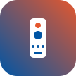
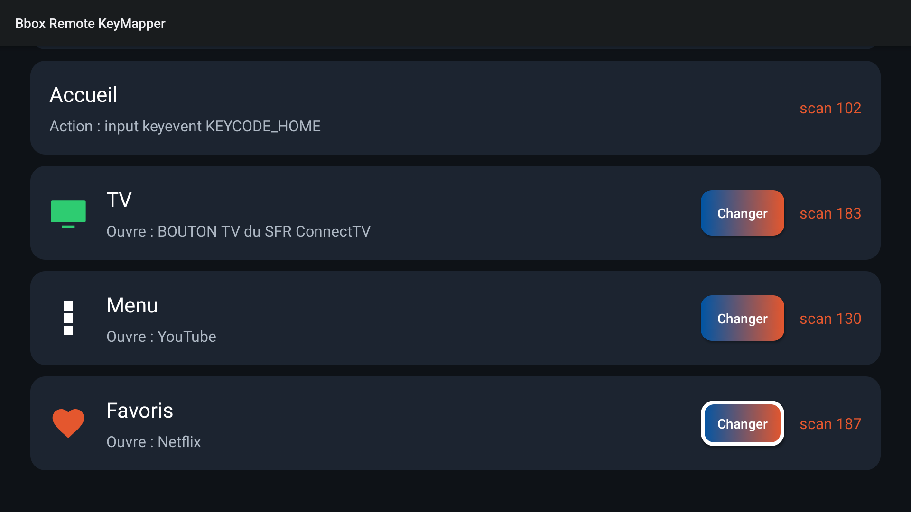

<p align="center">
  
</p>

<h1 align="center">Bbox Remote KeyMapper</h1>

<p align="center">
  
  
</p>

<p align="center">
  Relie les touches de la télécommande <strong>Bbox Miami</strong> sur <strong>SFR Connect TV</strong> à des actions du décodeur ou à des applications.
</p>

L'application se connecte elle-même au démon ADB du décodeur (`127.0.0.1:5555`) et lit la télécommande : aucun PC n'est nécessaire une fois l'application installée.

<p align="center">
  
</p>

> **Compatibilité** : testé uniquement sur un décodeur **SFR Connect TV** (Android TV 12) avec une télécommande **Bbox Miami**. Les autres boîtiers Android TV n'ont pas été testés.
>
> **Prérequis important** : depuis une mise à jour déployée par SFR en **décembre 2025**, l'accès aux options pour développeurs (et donc au débogage ADB) est verrouillé par un mot de passe opérateur. Une méthode permettant de le retrouver est documentée sur [ce dépôt](LIEN_DU_DEPOT).

---

## Sommaire

- [Touches reliées](#-touches-reliées)
- [Activer le mode développeur et ADB](#-activer-le-mode-développeur-et-adb)
- [Installation sur le décodeur](#-installation-sur-le-décodeur)
- [Utilisation](#-utilisation)
- [Fonctionnement et limites](#-fonctionnement-et-limites)
- [Dépannage](#-dépannage)
- [Compilation et développement](#-compilation-et-développement)

---

## 🎛️ Touches reliées

Codes issus de la table `AdbWatchService.BUTTONS` et des captures `getevent` faites sur la télécommande `Telecommande`.

| Touche | Code scan (hex) | Code scan (déc.) | Nom noyau | Action par défaut |
|---|---|---|---|---|
| 🎬 **VOD** | `00ba` | 186 | KEY_F16 | `KEYCODE_SDMCEXTEND6` (REPLAY) |
| ↩️ **Retour** | `0001` | 1 | KEY_ESC | `KEYCODE_BACK` |
| 🏠 **Accueil** | `0066` | 102 | KEY_HOME | `KEYCODE_HOME` |
| 📺 **TV** | `00b7` | 183 | KEY_F13 | `KEYCODE_SDMCEXTEND2` (bouton TV d'origine du SFR) |
| ⋮ **Menu** | `0082` | 130 | KEY_PROPS | application (YouTube par défaut) |
| ❤️ **Favoris** | `00bb` | 187 | KEY_F17 | application (Netflix par défaut) |

Les touches **TV**, **Menu** et **Favoris** peuvent être changées depuis l'écran de l'application, avec le bouton **Changer**. Pour la touche TV, le premier choix du sélecteur rétablit l'action d'origine.

Les autres touches sont gérées nativement par Android TV.

<details>
<summary>Référence : télécommande d'origine</summary>

Le bouton REPLAY de la télécommande d'origine envoie le scancode `0x195` (405) sur le périphérique `RemoteB038`. Le système le traduit en `KEYCODE_SDMCEXTEND6`, qui lance REPLAY via le service `GlobalKey`.

</details>

---

## 🔧 Activer le mode développeur et ADB

> **Note (mise à jour SFR de décembre 2025)** : suite à une mise à jour système déployée par SFR en décembre 2025, l'activation du mode développeur est désormais protégée par un mot de passe défini par l'opérateur. L'accès ADB étant indispensable au fonctionnement de l'application, ces étapes nécessitent soit d'avoir déverrouillé ces options avant la mise à jour, soit de récupérer ce mot de passe grâce à la technique documentée sur [ce dépôt](https://github.com/dotkl3m/dev_mode_unlock).

Les libellés des menus ci-dessous peuvent varier selon la version du système :

1. Ouvrez les **Paramètres** du décodeur, puis **Préférences de l'appareil** (ou **À propos**).
2. Sélectionnez **Informations sur le système**, puis **Numéro de build** (ou **Version**), et appuyez plusieurs fois dessus jusqu'à l'apparition d'un message indiquant que les options pour développeurs sont activées.
3. Revenez aux paramètres, ouvrez **Options pour les développeurs**.
4. Activez **Débogage USB** et, si le menu le propose, **Débogage réseau** (ou **Débogage ADB sur le réseau**).

Documentation officielle Android : [Options pour les développeurs](https://developer.android.com/studio/debug/dev-options).

---

## 📦 Installation sur le décodeur

Le débogage ADB doit être actif sur le décodeur, car l'application s'y connecte elle-même (`127.0.0.1:5555`). Voir [Activer le mode développeur et ADB](#-activer-le-mode-développeur-et-adb).

Récupérez l'APK `app-debug.apk` : il est disponible dans l'onglet [**Releases**](https://github.com/QuentinMarical/bbox-remote-keymapper/releases) du dépôt, ou se compile comme indiqué plus bas.

Ensuite, deux méthodes pour l'installer :

**Méthode 1 : depuis le décodeur**

1. Copiez `app-debug.apk` sur le décodeur, par exemple depuis une clé USB, et installez-le avec un gestionnaire de fichiers.
2. Ouvrez l'application une fois.

**Méthode 2 : depuis un PC avec ADB**

Il faut ADB sur l'ordinateur. Le plus sûr est d'installer les [platform-tools officiels de Google](https://developer.android.com/tools/releases/platform-tools). Sous Windows, `winget install Google.PlatformTools` ; sous macOS, `brew install android-platform-tools`.

Ensuite, remplacez `192.168.1.100` par l'adresse IP de votre décodeur (affichée dans **Réseau** ou **Informations réseau**), puis :

```bash
adb connect 192.168.1.100:5555
adb install -r app-debug.apk
```

**Première ouverture : la popup d'autorisation.** Au premier lancement, l'application démarre le pont ADB, et le décodeur affiche une demande d'autorisation du débogage depuis `127.0.0.1`. Regardez l'écran du téléviseur à ce moment-là et cochez **Toujours autoriser**. Sans cela, l'application semble inactive.

---

## ▶️ Utilisation

1. Ouvrez l'application sur le décodeur : le pont ADB démarre tout seul.
2. Si le pont est arrêté, le bouton **Relancer le pont** le redémarre.
3. Pour changer une touche, cliquez sur **Changer** et choisissez l'application dans la liste.
4. Au démarrage du décodeur, le pont se relance seul.

---

## ⚠️ Fonctionnement et limites

- Le pont s'exécute au premier plan avec une notification, pour qu'Android ne l'arrête pas quand l'application est inactive.
- Pendant la veille, le réseau du décodeur est coupé : le pont se reconnecte au réveil, en réessayant toutes les 3 à 10 secondes.
- Le numéro `/dev/input/eventN` de la télécommande change parfois au redémarrage : le pont retrouve la télécommande par son nom d'entrée `Telecommande`.
- Les choix faits dans le sélecteur sont enregistrés sur le décodeur et restent après un redémarrage.

---

## 🩺 Dépannage

- **Le pont reste arrêté** : vérifiez que le débogage réseau (ADB) est toujours activé dans les options pour développeurs. Il peut se désactiver après un redémarrage ou une mise à jour du décodeur.
- **Les touches reliées ne réagissent pas** : vérifiez que la télécommande est bien appairée dans les paramètres Bluetooth d'Android TV. Le pont la retrouve par son nom d'entrée `Telecommande`.
- **L'application semble inactive au premier lancement** : regardez l'écran du téléviseur et cochez **Toujours autoriser** dans la demande d'autorisation ADB.

---

## 🛠️ Compilation et développement

Le projet ne contient pas le wrapper Gradle. Il faut :
- JDK 17 ou plus ;
- Gradle 8.7 ;
- Android SDK : plate-forme `android-34` et build-tools `34.0.0`.

Avec Android Studio, ouvrez le dossier du projet puis **Build > Build APK(s)**. En ligne de commande :

```bash
gradle assembleDebug
```

L'APK est généré dans `app/build/outputs/apk/debug/app-debug.apk`.

### Ajouter une touche

1. Relevez le code hexadécimal de la touche avec `getevent` : ouvrez un terminal ADB connecté au décodeur, lancez `adb shell getevent -l`, puis appuyez sur la touche pour repérer la ligne `EV_KEY`. Relancez ensuite `adb shell getevent` (sans `-l`) pour lire le code brut :
   ```text
   /dev/input/event2: 0001 00ba 00000001
   ```
   Ici, `0001` correspond à `EV_KEY` et le deuxième groupe (`00ba`) est le code hexadécimal à reporter.
2. Ajoutez une ligne dans la table `BUTTONS` de `app/src/main/java/fr/bbox/keymapper/AdbWatchService.java` : code scan hexadécimal sur quatre chiffres, libellé, et commande shell. Pour une touche qui lance une application au choix, utilisez la constante `APP`.
3. Recompilez et réinstallez l'application.